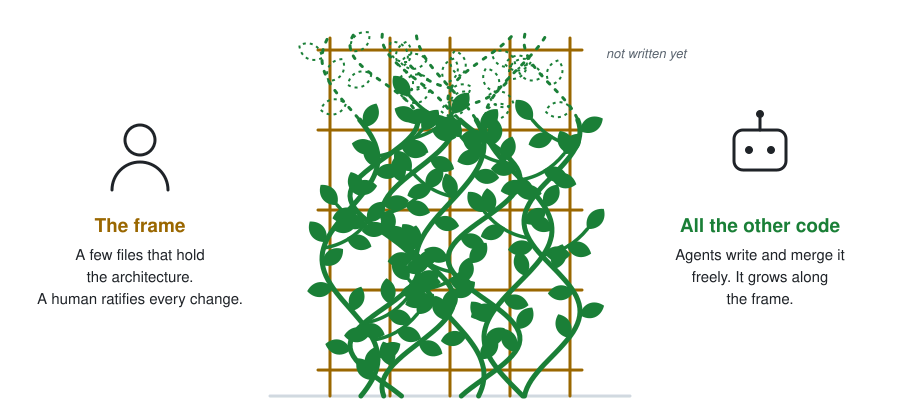

# Trellis

## Why every codebase needs a trellis

We want coding agents (that are part of a [software factory](https://grovehq.com/blog/software-factory)) to have more and more autonomy, up to and including approving and merging each other's PRs.

But some bugs are a lot worse than others. A route that ships without an auth check, or one tenant's data reaching another tenant, is a bug you can't afford even once. Telling an agent not to introduce one works most of the time, but most of the time isn't good enough for these kinds of bugs.

The way to avoid them is strong architectural patterns. If, for example, every route is built from one auth wrapper, and every query goes through one tenant-scoped client, then as long as that pattern is followed, entire classes of bugs are unreachable.

However, a pattern only protects you if all of the code follows it, and an agent trying to get a test to pass may not follow the pattern when there is a shorter path. So you need something that enforces the patterns across the codebase: checks that fail the build when code skips one, and a human who ratifies any change to those checks. That is Trellis. Everywhere else, the agents can get on with it.

### Why call it trellis?

A trellis is a frame that a plant grows along. The gardener doesn't place each shoot. They build the frame, and the plant fills it in at its own speed, in the shape the frame allows.

A codebase written by agents grows the same way. You can't inspect every line, but you can build the frame. The frame is a small set of files that decides the shape of all the other code, the code written last year and the code written next month. All of it needs to stay on the frame.

<picture>
  <source media="(prefers-color-scheme: dark)" srcset="docs/images/trellis-dark.svg">
  
</picture>

## How Trellis achieves this

Trellis does two things.

**1. It provides a framework that makes the frame something only a human can change.** Certain files in the codebase form the frame: the lint rules, types, dependency rules and CI workflows that hold your architectural invariants. An agent can propose a change to a frame file like any other change. It can't land one until a human has ratified that exact change with proof of presence. Proof of presence is a signature that, for example, uses the person's fingerprint to ensure they have signed off on the change (which an agent working with that person's credentials can't supply).

What goes into the frame is the smallest amount of code that holds the invariant. A small frame is one a human can actually read when asked to ratify a change to it, and it leaves everything outside it free for agents to change.

**2. It provides utilities and patterns for the common checks that should be in a frame.** The [utilities](#utilities) are checks you configure. The [patterns](#patterns) show how to use the framework and the utilities to enforce an architectural pattern, so that coding agents stick to it.

## Utilities

The utilities supplied here are the ones we commonly use under many of the architectural patterns we have established in Grove. We found we needed to layer a few things on top of the foundation of ESLint, dependency-cruiser and the like.

- [Import fences](docs/utilities/import-fences.md): make one file the only way to reach a module.

## Patterns

Each pattern is an architectural guarantee and the way to enforce it. They are shown working in the [sample app](https://github.com/grove-hq/trellis-sample).

- [Authentication](docs/patterns/authentication.md): no request reaches a handler without an authenticated caller.
- [Tenant isolation](docs/patterns/tenant-isolation.md): no query reads or writes another tenant's data.

## What Trellis does not do (a bit of a disclaimer)

Trellis only checks that a mechanism is present and reached the right way. It does not judge whether the mechanism is correct; that is up to you. Please, please don't assume you can adopt Trellis and your coding agents will produce secure code. Trellis helps you focus your attention where it is needed most, but the architectural patterns that make your coding agents produce the right code are unique to your codebase and your application. We have found that manual review and red teaming are necessary to maintain your ever-evolving frames, which, in turn, maintain your ever-evolving codebase.

## License

Apache-2.0. See [LICENSE](LICENSE).
